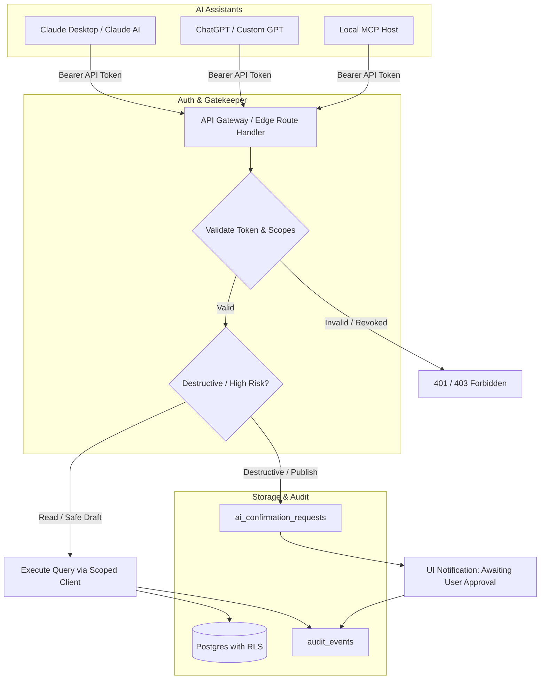

# AI Integration Boundary Architecture (MCP & External Assistants)

## 1. Executive Summary

The application will expose authenticated interfaces allowing external AI assistants—such as **Claude** (via Model Context Protocol / MCP) and **ChatGPT** (via Actions / Functions)—to interact with content items, tasks, and calendar records.

To guarantee workspace isolation, non-repudiation, and defense-in-depth, **AI assistants are never given direct database credentials, service-role privileges, or shared browser sessions**. Instead, they operate as distinct API clients subject to granular scopes, continuous authorization checks, strict audit trails, and mandatory human confirmation for high-risk operations.

---

## 2. Architectural Diagram

---

## 3. Core Security Principles

### 3.1. Dedicated AI API Tokens
- Each AI client is assigned an individual token record in `ai_api_tokens`.
- The secret token is generated using cryptographically secure random bytes (e.g. `ctc_live_32bytes_hex`) and shown **once** to the user at creation time.
- The database stores only a salted **SHA-256 hash** of the token (`token_hash`) alongside a visible prefix (`token_prefix`) for easy identification in the UI.
- Tokens are bound to a specific `workspace_id` and cannot access data outside that workspace.

### 3.2. Explicit, Granular Scopes
Tokens are restricted by a predefined scope array:
- `content:read`: Search and read content ideas, drafts, and schedule items.
- `content:write`: Create new content ideas or edit draft copy.
- `task:read`: Query tasks, subtasks, deadlines, and project associations.
- `task:write`: Create tasks, mark tasks complete, update descriptions.
- `calendar:read`: View day, week, month schedules and free/busy time slots.
- `calendar:reschedule`: Move scheduled dates or update durations.
- `action:confirm_required`: Forces all destructive or public actions to route through the confirmation workflow.

### 3.3. Two-Phase Confirmation for High-Risk Actions
The following operations **cannot be executed autonomously** by an AI agent, regardless of granted scopes:
1. Deleting tasks or content items.
2. Bulk rescheduling (> 3 items simultaneously).
3. Modifying social account configurations.
4. Generating or revoking other API tokens.

**The Confirmation Workflow**:
1. When an AI client invokes a high-risk tool (e.g. `delete_task`), the backend does not delete the task.
2. The backend creates a record in `ai_confirmation_requests` containing:
   - Proposed action (`delete_task`)
   - Target entity ID
   - Exact payload parameters
   - Expiration timestamp (e.g. 15 minutes)
   - Status: `pending`
3. The AI receives a response: `{"status": "confirmation_required", "request_id": "...", "summary": "Deletion of task 'Q3 Roadmap' requires user approval in the web app."}`.
4. The user receives an in-app banner/modal in the web application with an **Approve** or **Reject** button.
5. If approved, the server executes the mutation and marks the request `approved`.

### 3.4. Immutable Audit Ledger
Every tool execution by an AI assistant creates an immutable row in `audit_events`:
- `actor_type`: `'ai_client'`
- `actor_id`: `ai_api_token_id`
- `event_type`: e.g. `'content.draft_created'`, `'task.rescheduled'`
- `details`: Tool name, input parameters, affected record IDs
- `ip_address` & `user_agent`: Request metadata

### 3.5. Instant Revocation
At any moment, a user can click **Revoke** in the workspace settings. The token is immediately marked `is_revoked = true` in the database, invalidating any active MCP sessions or GPT Actions within milliseconds.

---

## 4. Planned MCP Tool Definitions (Phase 4 Implementation)

Rather than giving the AI generic SQL access, the system will expose a strictly typed tool catalog:

| Tool Name | Scope Required | Risk Level | Description |
| :--- | :--- | :--- | :--- |
| `search_content` | `content:read` | Low | Search content ideas and scheduled items by keyword, platform, status, or tag. |
| `create_content_item` | `content:write` | Low | Draft a new post, comment, or reply in the idea inbox or as a scheduled draft. |
| `update_content_item` | `content:write` | Medium | Update the title, body, platform, or tags of an existing content item. |
| `delete_content_item` | `content:write` | **High (Requires Confirmation)** | Request deletion of a content item. |
| `list_tasks` | `task:read` | Low | Retrieve tasks filtered by status, priority, due date range, or project. |
| `create_task` | `task:write` | Low | Create a new task with optional subtasks, priority, and due date. |
| `update_task` | `task:write` | Medium | Update task status, title, description, or priority. |
| `delete_task` | `task:write` | **High (Requires Confirmation)** | Request deletion of a task. |
| `get_calendar_view` | `calendar:read` | Low | Retrieve combined content and task calendar events for a date window. |
| `reschedule_item` | `calendar:reschedule`| Medium | Adjust the scheduled start/end or scheduled publishing time for an item. |

---

## 5. Compatibility Realities (Claude vs ChatGPT)

- **Claude Desktop & Anthropic MCP**: Uses JSON-RPC over `stdio` (local subprocess) or Server-Sent Events (SSE) over HTTP. The server will support an authenticated SSE endpoint for remote Claude connections.
- **ChatGPT GPT Actions**: Uses standard OpenAPI 3.1 REST endpoints with HTTP Bearer authentication.
- **Shared Backend Layer**: Both protocols will map directly to the same internal service layer in `src/lib/services/`, ensuring identical authorization checks, validation schemas, and audit logging regardless of which assistant is calling.
