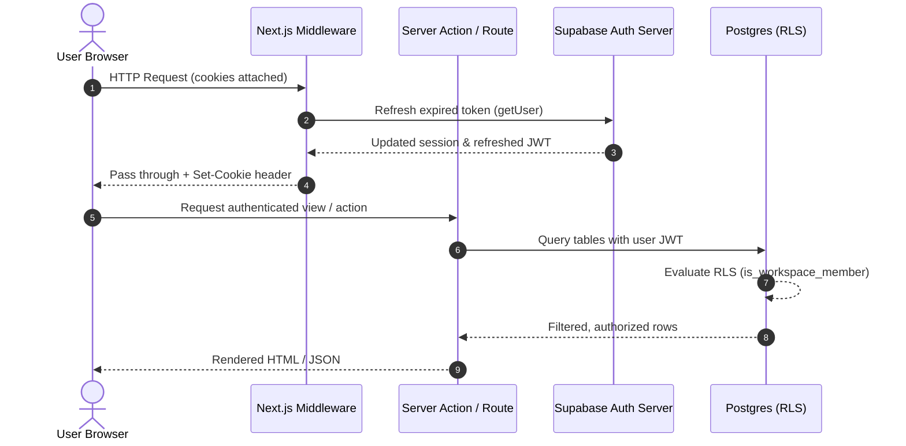

# Authentication and Security Architecture

## 1. Authentication System Overview

The **Content & Task Command Center** uses **Supabase Auth** paired with the official Next.js Server-Side Rendering package (`@supabase/ssr`).

Authentication features supported:
- **Email & Password**: Registration, verification, password sign-in, and password recovery.
- **Google OAuth**: Third-party federated authentication via OpenID Connect (PKCE flow).
- **Session Lifecycle**: Secure HTTP-only cookies, automatic token refreshing in Next.js middleware, and immediate server-side session termination upon sign-out.
- **Automatic Provisioning**: PostgreSQL database triggers immediately provision a `profiles` record and an initial "Personal Workspace" for every new user, assigning them the `owner` role.

---

## 2. Token & Session Management Flow

Next.js App Router applications require careful session synchronization between Server Components, Server Actions, Route Handlers, Middleware, and Client Components.



### Critical Rules Followed:
1. **Never use `supabase.auth.getSession()` in server code or middleware**: `getSession()` merely reads the unverified local cookie JWT without validating its signature or revocation status against Supabase. We strictly use `supabase.auth.getUser()`, which validates the token with Supabase Auth servers.
2. **Server-Side Cookie Handlers**: Using `@supabase/ssr`, cookie reads and writes are managed through `getAll` and `setAll` handlers attached to the Next.js `NextRequest` and `NextResponse`.
3. **Protected Route Boundary**: Next.js middleware (`src/middleware.ts`) protects operational routes (e.g. `/dashboard/*`, `/settings/*`), redirecting unauthenticated users to `/auth/sign-in`. Authenticated users attempting to visit login/register routes are redirected to `/dashboard`.

---

## 3. Database Security & Row Level Security (RLS)

### 3.1. Fundamental Security Boundaries
- **RLS Enabled Everywhere**: Every public application table has `ALTER TABLE ... ENABLE ROW LEVEL SECURITY;` applied. By default in Postgres, no user can read or write any row unless an explicit policy permits it.
- **No Reliance on Client-Supplied User IDs**: All RLS policies reference `auth.uid()`, the cryptographically signed user ID extracted from the verified Supabase JWT.
- **Strict Role-Based Hierarchy**:
  - `owner`: Full control, workspace deletion, billing, member invites.
  - `admin`: Content creation, task management, member management, token generation.
  - `member`: Content creation, editing, task management.
  - `viewer`: Read-only access to workspace content and tasks.

### 3.2. Security Definer Helper Functions
To avoid policy recursion when querying `workspace_members` within a policy, the database provides `SECURITY DEFINER` functions with fixed `search_path`:

```sql
CREATE OR REPLACE FUNCTION public.is_workspace_member(
    lookup_workspace_id UUID,
    required_role TEXT DEFAULT 'viewer'
)
RETURNS BOOLEAN
LANGUAGE plpgsql
SECURITY DEFINER
SET search_path = public, pg_temp
AS $$
DECLARE
    user_role TEXT;
BEGIN
    IF auth.uid() IS NULL THEN
        RETURN FALSE;
    END IF;

    SELECT role INTO user_role
    FROM public.workspace_members
    WHERE workspace_id = lookup_workspace_id
      AND user_id = auth.uid();

    IF user_role IS NULL THEN
        RETURN FALSE;
    END IF;

    IF required_role = 'viewer' THEN
        RETURN TRUE;
    ELSIF required_role = 'member' AND user_role IN ('owner', 'admin', 'member') THEN
        RETURN TRUE;
    ELSIF required_role = 'admin' AND user_role IN ('owner', 'admin') THEN
        RETURN TRUE;
    ELSIF required_role = 'owner' AND user_role = 'owner' THEN
        RETURN TRUE;
    END IF;

    RETURN FALSE;
END;
$$;
```

### 3.3. Prevention of Ownership Field Tampering
To prevent malicious users from altering `workspace_id` or `owner_id` on existing records to hijack or leak records across workspace boundaries, triggers enforce immutable ownership:

```sql
CREATE OR REPLACE FUNCTION public.enforce_immutable_workspace()
RETURNS TRIGGER
LANGUAGE plpgsql
AS $$
BEGIN
    IF NEW.workspace_id <> OLD.workspace_id THEN
        RAISE EXCEPTION 'Changing workspace_id is forbidden.';
    END IF;
    RETURN NEW;
END;
$$;
```

---

## 4. Required External Configuration

### 4.1. Supabase Dashboard Configuration
1. **Authentication Settings**:
   - Navigate to **Authentication -> URL Configuration**.
   - Set **Site URL** to:
     - Local: `http://localhost:3000`
     - Production: `https://your-domain.com`
   - Add **Redirect URLs**:
     - `http://localhost:3000/auth/callback`
     - `https://your-domain.com/auth/callback`
     - `http://localhost:3000/auth/reset-password`
     - `https://your-domain.com/auth/reset-password`
2. **Email Provider**:
   - Enabled by default under **Authentication -> Providers -> Email**.
   - For production, configure custom SMTP (e.g. Resend, SendGrid) rather than the built-in rate-limited Supabase testing mailer.
3. **Google OAuth Provider**:
   - Navigate to **Authentication -> Providers -> Google**.
   - Toggle **Enable Google provider**.
   - Input **Client ID** and **Client Secret** obtained from Google Cloud Console.

### 4.2. Google Cloud Console Configuration
1. Open the **Google Cloud Console** (Credentials page).
2. Create an **OAuth 2.0 Client ID** (Web application).
3. Set **Authorized JavaScript origins**:
   - `http://localhost:3000`
   - `https://<your-supabase-project-id>.supabase.co`
   - `https://your-production-domain.com`
4. Set **Authorized redirect URIs**:
   - `https://<your-supabase-project-id>.supabase.co/auth/v1/callback`
5. Copy the generated **Client ID** and **Client Secret** into your Supabase Dashboard Google provider settings.

---

## 5. Evolution to Multi-User Collaboration

When inviting additional users is enabled in future phases:
1. Workspace admins create invitation records in an `invitations` table.
2. Invited users receive an authenticated token or magic link.
3. Upon acceptance, a row is inserted into `workspace_members` with the chosen role.
4. **Existing RLS policies require zero modification**: because policies filter on `is_workspace_member(workspace_id)`, the newly added user immediately gains access to all relevant workspace records according to their role.
