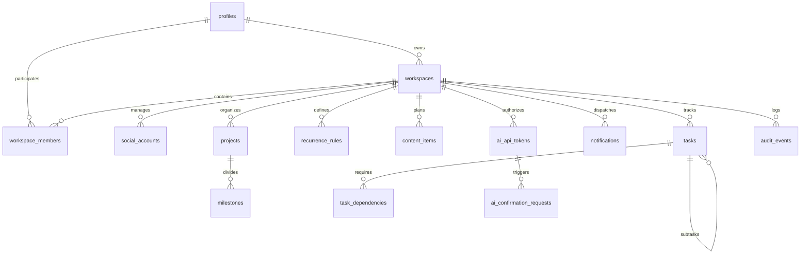

# Database Schema Specification

## 1. Architectural Philosophy & Principles

The database design for the **Content & Task Command Center** adheres to the following principles:

1. **Workspace-Centric Multi-Tenancy**: The application is personal-first, but every domain entity belongs to a `workspace_id`. A single user starts with their default personal workspace (`owner` role). When team members, collaborators, or multiple separate workspaces (e.g., personal, client, consulting) are introduced later, no database migrations or fundamental query rewrites will be required.
2. **Unified Scheduling Model**: Both social content items and personal tasks share identical temporal semantics: timestamps are stored with time zone in UTC (`TIMESTAMPTZ`), linked to optional shared recurrence rules (`recurrence_rules`), and presented to users converted to their profile's configured IANA time zone (e.g. `America/New_York`, `UTC`).
3. **Normalized Social Platform Content Model**: Rather than creating disjoint, redundant tables for LinkedIn, Reddit, Threads, and X, social interactions are modeled using a unified `content_items` entity. Common metadata (headline, body, status, schedule, media attachments, tags, project associations) are normalized, while platform-specific parameters (such as the target tweet ID, subreddit, or thread parent) are safely encapsulated in structured JSONB (`target_reference`).
4. **Defense-in-Depth Security**: Row Level Security (RLS) is enabled on all tables in the public schema. Helper functions execute with `SECURITY DEFINER` and fixed search paths to safely evaluate workspace membership without recursive policy triggers.
5. **AI Integration Isolation**: AI clients operate via dedicated API tokens (`ai_api_tokens`) mapped to specific granular scopes and workspaces, with all mutations logged in `audit_events` and high-risk operations routed through `ai_confirmation_requests`.

---

## 2. Entity-Relationship Overview

---

## 3. Detailed Entity Definitions

### 3.1. Authentication & Multi-Tenancy

#### `profiles`
Extends `auth.users` with application-specific metadata.
- **`id`** `UUID PRIMARY KEY REFERENCES auth.users(id) ON DELETE CASCADE`
- **`email`** `TEXT NOT NULL`
- **`full_name`** `TEXT`
- **`avatar_url`** `TEXT`
- **`timezone`** `TEXT NOT NULL DEFAULT 'UTC'` (valid IANA timezone string e.g. `'America/Los_Angeles'`, `'Europe/London'`)
- **`created_at`** `TIMESTAMPTZ NOT NULL DEFAULT now()`
- **`updated_at`** `TIMESTAMPTZ NOT NULL DEFAULT now()`

#### `workspaces`
Tenant boundary grouping all content, tasks, settings, and integrations.
- **`id`** `UUID PRIMARY KEY DEFAULT gen_random_uuid()`
- **`name`** `TEXT NOT NULL`
- **`slug`** `TEXT NOT NULL UNIQUE`
- **`owner_id`** `UUID NOT NULL REFERENCES profiles(id) ON DELETE RESTRICT`
- **`created_at`** `TIMESTAMPTZ NOT NULL DEFAULT now()`
- **`updated_at`** `TIMESTAMPTZ NOT NULL DEFAULT now()`

#### `workspace_members`
Association table connecting users to workspaces with granular roles.
- **`id`** `UUID PRIMARY KEY DEFAULT gen_random_uuid()`
- **`workspace_id`** `UUID NOT NULL REFERENCES workspaces(id) ON DELETE CASCADE`
- **`user_id`** `UUID NOT NULL REFERENCES profiles(id) ON DELETE CASCADE`
- **`role`** `TEXT NOT NULL CHECK (role IN ('owner', 'admin', 'member', 'viewer'))`
- **`joined_at`** `TIMESTAMPTZ NOT NULL DEFAULT now()`
- **Constraints**: `UNIQUE (workspace_id, user_id)`

---

### 3.2. Social Platforms & Identifiers

#### `social_accounts`
Platform accounts configured within a workspace (supports planning without requiring OAuth in Phase 1).
- **`id`** `UUID PRIMARY KEY DEFAULT gen_random_uuid()`
- **`workspace_id`** `UUID NOT NULL REFERENCES workspaces(id) ON DELETE CASCADE`
- **`platform`** `TEXT NOT NULL CHECK (platform IN ('linkedin', 'reddit', 'threads', 'x'))`
- **`account_handle`** `TEXT NOT NULL` (e.g. `'@alexdev'`)
- **`account_name`** `TEXT` (e.g. `'Alex Developer'`)
- **`avatar_url`** `TEXT`
- **`status`** `TEXT NOT NULL DEFAULT 'draft' CHECK (status IN ('draft', 'connected', 'disconnected'))`
- **`created_at`** `TIMESTAMPTZ NOT NULL DEFAULT now()`
- **`updated_at`** `TIMESTAMPTZ NOT NULL DEFAULT now()`
- **Constraints**: `UNIQUE (workspace_id, platform, account_handle)`

---

### 3.3. Projects, Milestones & Recurrence

#### `projects`
Organizational groupings for campaigns, launches, and personal initiatives.
- **`id`** `UUID PRIMARY KEY DEFAULT gen_random_uuid()`
- **`workspace_id`** `UUID NOT NULL REFERENCES workspaces(id) ON DELETE CASCADE`
- **`name`** `TEXT NOT NULL`
- **`description`** `TEXT`
- **`color`** `TEXT DEFAULT '#2563eb'`
- **`status`** `TEXT NOT NULL DEFAULT 'active' CHECK (status IN ('active', 'completed', 'archived'))`
- **`created_by`** `UUID REFERENCES profiles(id) ON DELETE SET NULL`
- **`created_at`** `TIMESTAMPTZ NOT NULL DEFAULT now()`
- **`updated_at`** `TIMESTAMPTZ NOT NULL DEFAULT now()`

#### `milestones`
Target dates and deliverables within projects.
- **`id`** `UUID PRIMARY KEY DEFAULT gen_random_uuid()`
- **`workspace_id`** `UUID NOT NULL REFERENCES workspaces(id) ON DELETE CASCADE`
- **`project_id`** `UUID REFERENCES projects(id) ON DELETE CASCADE`
- **`title`** `TEXT NOT NULL`
- **`description`** `TEXT`
- **`due_date`** `TIMESTAMPTZ`
- **`is_completed`** `BOOLEAN NOT NULL DEFAULT false`
- **`created_at`** `TIMESTAMPTZ NOT NULL DEFAULT now()`
- **`updated_at`** `TIMESTAMPTZ NOT NULL DEFAULT now()`

#### `recurrence_rules`
Shared recurrence engine for tasks and regular social posting cadences.
- **`id`** `UUID PRIMARY KEY DEFAULT gen_random_uuid()`
- **`workspace_id`** `UUID NOT NULL REFERENCES workspaces(id) ON DELETE CASCADE`
- **`frequency`** `TEXT NOT NULL CHECK (frequency IN ('daily', 'weekly', 'monthly', 'yearly', 'custom'))`
- **`interval`** `INTEGER NOT NULL DEFAULT 1 CHECK (interval > 0)`
- **`by_weekday`** `INTEGER[]` (1 = Monday, 7 = Sunday as per ISO 8601)
- **`by_monthday`** `INTEGER[]` (1-31)
- **`until_date`** `TIMESTAMPTZ`
- **`count`** `INTEGER CHECK (count IS NULL OR count > 0)`
- **`timezone`** `TEXT NOT NULL DEFAULT 'UTC'`
- **`created_at`** `TIMESTAMPTZ NOT NULL DEFAULT now()`
- **`updated_at`** `TIMESTAMPTZ NOT NULL DEFAULT now()`

---

### 3.4. Content & Task Management

#### `content_items`
Unified representation of social media content items.
- **`id`** `UUID PRIMARY KEY DEFAULT gen_random_uuid()`
- **`workspace_id`** `UUID NOT NULL REFERENCES workspaces(id) ON DELETE CASCADE`
- **`social_account_id`** `UUID REFERENCES social_accounts(id) ON DELETE SET NULL`
- **`platform`** `TEXT NOT NULL CHECK (platform IN ('linkedin', 'reddit', 'threads', 'x'))`
- **`action_type`** `TEXT NOT NULL CHECK (action_type IN ('post', 'comment', 'reply', 'share', 'repost', 'reaction'))`
- **`status`** `TEXT NOT NULL DEFAULT 'idea' CHECK (status IN ('idea', 'draft', 'scheduled', 'publishing', 'published', 'failed', 'archived'))`
- **`title`** `TEXT` (headline, post hook, or thread summary)
- **`body`** `TEXT NOT NULL DEFAULT ''`
- **`scheduled_at`** `TIMESTAMPTZ` (`NULL` represents an unscheduled idea in the idea inbox)
- **`duration_minutes`** `INTEGER` (for blocking out publishing/engagement windows)
- **`media_urls`** `JSONB NOT NULL DEFAULT '[]'::jsonb`
- **`external_links`** `JSONB NOT NULL DEFAULT '[]'::jsonb`
- **`target_reference`** `JSONB` (reference to target post for comments/replies/reposts: `{ "url": "...", "post_id": "...", "author_handle": "..." }`)
- **`tags`** `TEXT[] NOT NULL DEFAULT '{}'`
- **`notes`** `TEXT`
- **`project_id`** `UUID REFERENCES projects(id) ON DELETE SET NULL`
- **`milestone_id`** `UUID REFERENCES milestones(id) ON DELETE SET NULL`
- **`recurrence_rule_id`** `UUID REFERENCES recurrence_rules(id) ON DELETE SET NULL`
- **`created_by`** `UUID REFERENCES profiles(id) ON DELETE SET NULL`
- **`created_at`** `TIMESTAMPTZ NOT NULL DEFAULT now()`
- **`updated_at`** `TIMESTAMPTZ NOT NULL DEFAULT now()`

#### `tasks`
Task tracking with hierarchical subtask support.
- **`id`** `UUID PRIMARY KEY DEFAULT gen_random_uuid()`
- **`workspace_id`** `UUID NOT NULL REFERENCES workspaces(id) ON DELETE CASCADE`
- **`parent_task_id`** `UUID REFERENCES tasks(id) ON DELETE CASCADE` (subtask tree)
- **`project_id`** `UUID REFERENCES projects(id) ON DELETE SET NULL`
- **`milestone_id`** `UUID REFERENCES milestones(id) ON DELETE SET NULL`
- **`title`** `TEXT NOT NULL`
- **`description`** `TEXT`
- **`priority`** `TEXT NOT NULL DEFAULT 'medium' CHECK (priority IN ('low', 'medium', 'high', 'urgent'))`
- **`status`** `TEXT NOT NULL DEFAULT 'todo' CHECK (status IN ('todo', 'in_progress', 'blocked', 'done', 'cancelled'))`
- **`scheduled_start`** `TIMESTAMPTZ`
- **`scheduled_end`** `TIMESTAMPTZ`
- **`due_date`** `TIMESTAMPTZ`
- **`estimated_duration_minutes`** `INTEGER`
- **`tags`** `TEXT[] NOT NULL DEFAULT '{}'`
- **`recurrence_rule_id`** `UUID REFERENCES recurrence_rules(id) ON DELETE SET NULL`
- **`created_by`** `UUID REFERENCES profiles(id) ON DELETE SET NULL`
- **`assigned_to`** `UUID REFERENCES profiles(id) ON DELETE SET NULL`
- **`created_at`** `TIMESTAMPTZ NOT NULL DEFAULT now()`
- **`updated_at`** `TIMESTAMPTZ NOT NULL DEFAULT now()`
- **Constraints**: `CHECK (scheduled_end IS NULL OR scheduled_start IS NULL OR scheduled_end >= scheduled_start)`

#### `task_dependencies`
Explicit dependency graphs between tasks.
- **`id`** `UUID PRIMARY KEY DEFAULT gen_random_uuid()`
- **`workspace_id`** `UUID NOT NULL REFERENCES workspaces(id) ON DELETE CASCADE`
- **`task_id`** `UUID NOT NULL REFERENCES tasks(id) ON DELETE CASCADE`
- **`depends_on_task_id`** `UUID NOT NULL REFERENCES tasks(id) ON DELETE CASCADE`
- **`dependency_type`** `TEXT NOT NULL DEFAULT 'finish_to_start' CHECK (dependency_type IN ('finish_to_start', 'start_to_start', 'finish_to_finish', 'start_to_finish'))`
- **`created_at`** `TIMESTAMPTZ NOT NULL DEFAULT now()`
- **Constraints**: `UNIQUE (task_id, depends_on_task_id)`, `CHECK (task_id != depends_on_task_id)`

---

### 3.5. Notifications, AI Permissions & Audit Log

#### `notifications`
Server-side notification records for reminders and system alerts.
- **`id`** `UUID PRIMARY KEY DEFAULT gen_random_uuid()`
- **`workspace_id`** `UUID NOT NULL REFERENCES workspaces(id) ON DELETE CASCADE`
- **`recipient_id`** `UUID NOT NULL REFERENCES profiles(id) ON DELETE CASCADE`
- **`channel`** `TEXT NOT NULL CHECK (channel IN ('in_app', 'email'))`
- **`title`** `TEXT NOT NULL`
- **`message`** `TEXT NOT NULL`
- **`entity_type`** `TEXT CHECK (entity_type IN ('task', 'content_item', 'system', 'ai_request'))`
- **`entity_id`** `UUID`
- **`scheduled_for`** `TIMESTAMPTZ NOT NULL DEFAULT now()`
- **`status`** `TEXT NOT NULL DEFAULT 'pending' CHECK (status IN ('pending', 'delivered', 'failed', 'dismissed'))`
- **`delivered_at`** `TIMESTAMPTZ`
- **`created_at`** `TIMESTAMPTZ NOT NULL DEFAULT now()`

#### `ai_api_tokens`
Cryptographically hashed API credentials for AI clients (MCP, Claude, ChatGPT).
- **`id`** `UUID PRIMARY KEY DEFAULT gen_random_uuid()`
- **`workspace_id`** `UUID NOT NULL REFERENCES workspaces(id) ON DELETE CASCADE`
- **`client_name`** `TEXT NOT NULL` (e.g. `'Claude Desktop MCP'`, `'OpenAI GPT Action'`)
- **`token_hash`** `TEXT NOT NULL UNIQUE` (SHA-256 hash of secret token)
- **`token_prefix`** `TEXT NOT NULL` (e.g. `'ctc_live_...'` for display)
- **`scopes`** `TEXT[] NOT NULL` (e.g. `ARRAY['content:read', 'content:write', 'task:read', 'task:write']`)
- **`is_revoked`** `BOOLEAN NOT NULL DEFAULT false`
- **`created_by`** `UUID NOT NULL REFERENCES profiles(id) ON DELETE CASCADE`
- **`last_used_at`** `TIMESTAMPTZ`
- **`expires_at`** `TIMESTAMPTZ`
- **`created_at`** `TIMESTAMPTZ NOT NULL DEFAULT now()`

#### `ai_confirmation_requests`
Two-phase confirmation queue for destructive or sensitive AI operations.
- **`id`** `UUID PRIMARY KEY DEFAULT gen_random_uuid()`
- **`workspace_id`** `UUID NOT NULL REFERENCES workspaces(id) ON DELETE CASCADE`
- **`ai_token_id`** `UUID NOT NULL REFERENCES ai_api_tokens(id) ON DELETE CASCADE`
- **`operation`** `TEXT NOT NULL` (e.g. `'delete_task'`, `'delete_content'`, `'bulk_reschedule'`)
- **`payload`** `JSONB NOT NULL` (full arguments of proposed operation)
- **`status`** `TEXT NOT NULL DEFAULT 'pending' CHECK (status IN ('pending', 'approved', 'rejected', 'expired'))`
- **`requested_at`** `TIMESTAMPTZ NOT NULL DEFAULT now()`
- **`responded_at`** `TIMESTAMPTZ`
- **`responded_by`** `UUID REFERENCES profiles(id) ON DELETE SET NULL`
- **`expires_at`** `TIMESTAMPTZ NOT NULL`

#### `audit_events`
Immutable ledger recording all system, user, and AI client actions.
- **`id`** `UUID PRIMARY KEY DEFAULT gen_random_uuid()`
- **`workspace_id`** `UUID NOT NULL REFERENCES workspaces(id) ON DELETE CASCADE`
- **`actor_type`** `TEXT NOT NULL CHECK (actor_type IN ('user', 'ai_client', 'system'))`
- **`actor_id`** `TEXT NOT NULL` (user profile UUID or AI token UUID)
- **`event_type`** `TEXT NOT NULL` (e.g. `'content.created'`, `'task.rescheduled'`, `'ai_token.revoked'`)
- **`entity_type`** `TEXT NOT NULL`
- **`entity_id`** `UUID`
- **`details`** `JSONB NOT NULL DEFAULT '{}'::jsonb`
- **`ip_address`** `TEXT`
- **`user_agent`** `TEXT`
- **`created_at`** `TIMESTAMPTZ NOT NULL DEFAULT now()`

---

## 4. Key Performance Indexes

To support rapid unified calendar queries, Kanban boards, and timeline filtering, the following B-tree and composite indexes are defined:

1. **Unified Calendar Queries**:
   - `idx_content_items_calendar`: `(workspace_id, scheduled_at) WHERE scheduled_at IS NOT NULL`
   - `idx_tasks_calendar`: `(workspace_id, scheduled_start, scheduled_end) WHERE scheduled_start IS NOT NULL`
   - `idx_tasks_due_date`: `(workspace_id, due_date) WHERE due_date IS NOT NULL`
2. **Content Inbox & Board**:
   - `idx_content_items_status`: `(workspace_id, status)`
   - `idx_content_items_platform`: `(workspace_id, platform)`
3. **Task Board & Hierarchy**:
   - `idx_tasks_status_priority`: `(workspace_id, status, priority)`
   - `idx_tasks_parent`: `(parent_task_id)`
4. **Multi-Tenant Access & Membership**:
   - `idx_workspace_members_user`: `(user_id, workspace_id)`
   - `idx_workspaces_slug`: `(slug)`
5. **Notifications**:
   - `idx_notifications_pending`: `(recipient_id, status, scheduled_for) WHERE status = 'pending'`
6. **Audit & Token Verification**:
   - `idx_ai_tokens_hash`: `(token_hash) WHERE is_revoked = false`
   - `idx_audit_events_workspace_time`: `(workspace_id, created_at DESC)`

---

## 5. Architectural Trade-offs & Decision Record

| Decision | Selected Option | Alternatives Considered | Trade-off Rationale |
| :--- | :--- | :--- | :--- |
| **Multi-Tenancy** | Workspace-centric (`workspace_id` on all entities) | User-centric (`user_id` on all entities) | Personal users start with 1 workspace. When adding team collaboration or agencies managing client accounts, zero schema redesign or data migration is needed. |
| **Social Content Model** | Unified `content_items` table with JSONB target reference | Separate tables (`linkedin_posts`, `x_tweets`, etc.) | Separate tables create 4x code duplication and prevent unified indexed calendar queries. The unified model allows unified calendar/timeline views across all platforms with a single query. |
| **Recurrence Engine** | Shared `recurrence_rules` entity | Inline recurrence columns on tasks and content | Separating recurrence into a standalone entity allows complex rules (e.g. every other Tuesday) to be reusable, audited, and tested independently of task execution. |
| **Timezone Management** | Store `TIMESTAMPTZ` in UTC; user `timezone` in `profiles` | Store local time strings + offset | Postgres `TIMESTAMPTZ` normalizes daylight saving time transitions and ensures deterministic ordering across calendar intervals. |
| **AI Credentials** | SHA-256 hashed tokens in `ai_api_tokens` table | Reusing user session cookies or service-role key | Service-role keys grant unrestricted bypass of RLS. Dedicated hashed tokens provide revocability, granular scope checks, and distinct audit attribution. |
