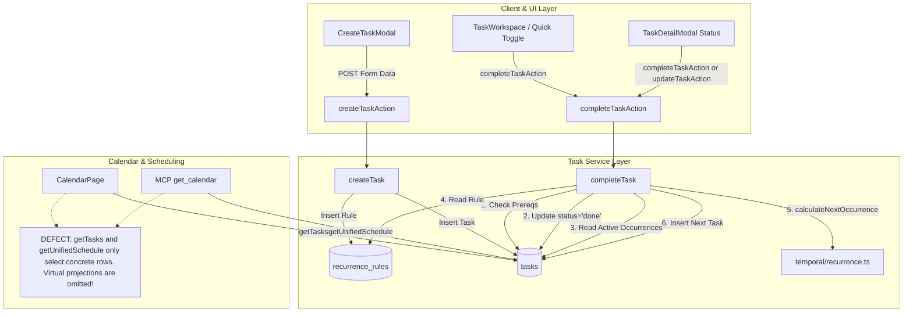
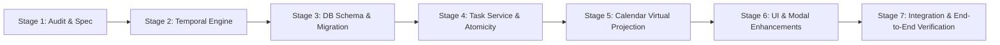

# Recurrence Engine Architecture Audit & Repair Specification

**Project**: Miler — Content & Task Command Center  
**Stage**: Stage 1 of 7 (Architecture Audit and Repair Specification)  
**Date**: November 10, 2026  
**Status**: APPROVED SPECIFICATION — READY FOR IMPLEMENTATION (Stages 2–7)  

---

## 1. Executive Summary & Audit Verdict

A rigorous code-level and test-backed audit of the recurring task implementation in Miler was conducted across the database schema, RLS policies, temporal recurrence engine, task service, scheduling service, server actions, web UI components, MCP dispatcher, CLI, and Vitest suite.

### Core Architecture Verdict: Retain the Hybrid Model
The existing **Hybrid Next-Occurrence Generation + Virtual Calendar Projection** model (first formulated in [docs/RECURRENCE_MODEL.md](file:///Users/temoooo/Downloads/miler%20creator/docs/RECURRENCE_MODEL.md)) remains fundamentally sound and must be **retained**. Pre-generating concrete rows in the database (e.g. 50–365 rows in advance) was rightly rejected because it causes database row bloat, requires destructive cascading updates upon rule changes, desynchronizes schedules on off-cadence completions, and triggers premature reminder spam.

However, the current implementation suffers from **ten verified defects** spanning temporal math bugs, missing projection layers, concurrency race conditions, and lack of UI editing. This document details each defect, establishes the target behavioral invariants, and specifies an implementation-ready repair roadmap across Stages 2 through 7.

---

## 2. Verified Defects & Source Locations

Every defect reported in the initial investigation has been independently traced, verified, and audited in the codebase.

```
┌──────────────────────────────────────────────────────────────────────────────────────────────────┐
│                                VERIFIED DEFECT MATRIX & IMPACT                                   │
├────┬─────────────────────────────┬──────────────────────────────────────┬────────────────────────┤
│ ID │ Defect Description          │ Primary Source Location              │ Severity & User Impact │
├────┼─────────────────────────────┼──────────────────────────────────────┼────────────────────────┤
│ D1 │ Calendar Omits Virtual      │ src/lib/services/scheduling-service  │ High: Future slots     │
│    │ Projections                 │ .ts#L95-L127, L160-L194;             │ invisible on calendar  │
│    │                             │ src/app/calendar/page.tsx#L124       │                        │
├────┼─────────────────────────────┼──────────────────────────────────────┼────────────────────────┤
│ D2 │ Status Updates Bypass       │ src/lib/services/task-service.ts     │ High: Recurrence       │
│    │ Next-Occurrence Generation  │ #L506-L583; src/lib/actions/         │ series silently dies   │
│    │                             │ task-actions.ts#L100-L180            │                        │
├────┼─────────────────────────────┼──────────────────────────────────────┼────────────────────────┤
│ D3 │ Recurrence `count` Limit    │ src/lib/temporal/recurrence.ts#L209; │ Medium: Bounded series │
│    │ Completely Ignored          │ src/lib/services/task-service.ts     │ repeat infinitely      │
│    │                             │ #L668-L720                           │                        │
├────┼─────────────────────────────┼──────────────────────────────────────┼────────────────────────┤
│ D4 │ Yearly Frequency Degrades   │ src/lib/temporal/recurrence.ts       │ High: Yearly task      │
│    │ to Daily Math; Unsupported  │ #L195-L207; src/lib/validation/      │ repeats next day;      │
│    │ Frequencies Approximated    │ task.ts#L5                           │ 'custom' silently daily│
├────┼─────────────────────────────┼──────────────────────────────────────┼────────────────────────┤
│ D5 │ Subtasks Not Cloned into    │ src/lib/services/task-service.ts     │ Medium: Checklists lost│
│    │ Next Occurrences            │ #L710-L717                           │ on subsequent cycles   │
├────┼─────────────────────────────┼──────────────────────────────────────┼────────────────────────┤
│ D6 │ Inability to View, Edit, or │ src/components/tasks/                │ Medium: Inflexible;    │
│    │ Remove Recurrence in UI     │ TaskDetailModal.tsx#L294;            │ must delete task to    │
│    │                             │ src/lib/validation/task.ts#L48       │ stop recurrence        │
├────┼─────────────────────────────┼──────────────────────────────────────┼────────────────────────┤
│ D7 │ Monthly Day Clamping Causes │ src/lib/temporal/recurrence.ts#L187; │ High: Jan 31 clamps to │
│    │ Permanent Day Drift         │ src/components/tasks/                │ Feb 28 and stays 28th  │
│    │                             │ CreateTaskModal.tsx#L445             │ forever                │
├────┼─────────────────────────────┼──────────────────────────────────────┼────────────────────────┤
│ D8 │ Non-Atomic Completion &     │ src/lib/services/task-service.ts     │ High: Duplicate active │
│    │ Concurrency Race Condition  │ #L628-L707; supabase/migrations/     │ tasks or missing rows  │
│    │                             │ 20261028000001_initial_schema.sql    │ under race conditions  │
├────┼─────────────────────────────┼──────────────────────────────────────┼────────────────────────┤
│ D9 │ Overdue Completion Creates  │ src/lib/services/task-service.ts     │ Medium: User must click│
│    │ Automatic Past Backlog      │ #L668-L670                           │ through stale past days│
├────┼─────────────────────────────┼──────────────────────────────────────┼────────────────────────┤
│ D10│ Cancelling Recurring Task   │ src/lib/services/task-service.ts     │ Medium: No way to skip │
│    │ Permanently Halts Series    │ #L740-L746                           │ one occurrence         │
└────┴─────────────────────────────┴──────────────────────────────────────┴────────────────────────┘
```

---

### Detailed Verification Notes by Defect

#### Defect 1: Calendar Omits Virtual Projections
* **Location**: [src/lib/services/scheduling-service.ts#L95-L127](file:///Users/temoooo/Downloads/miler%20creator/src/lib/services/scheduling-service.ts#L95-L127) and [src/app/calendar/page.tsx#L124-L129](file:///Users/temoooo/Downloads/miler%20creator/src/app/calendar/page.tsx#L124-L129).
* **Finding**: `getUnifiedSchedule` queries only concrete rows where `scheduled_start` or `due_date` falls in `[startDate, endDate]`. `generateOccurrencesInRange` in [src/lib/temporal/recurrence.ts](file:///Users/temoooo/Downloads/miler%20creator/src/lib/temporal/recurrence.ts#L224) is tested in unit tests, but is **never invoked** by any application service.
* **Impact**: Because only the single active occurrence exists in the database, navigating to future weeks or months on the calendar displays completely empty slots for recurring tasks.

#### Defect 2: Status Updates Bypass Next-Occurrence Generation
* **Location**: [src/lib/services/task-service.ts#L506-L583](file:///Users/temoooo/Downloads/miler%20creator/src/lib/services/task-service.ts#L506-L583) and [src/lib/actions/task-actions.ts#L100-L180](file:///Users/temoooo/Downloads/miler%20creator/src/lib/actions/task-actions.ts#L100-L180).
* **Finding**: `updateTask` accepts `status: 'done'`. When supplied, it updates `status = 'done'` and sets `completed_at`, but contains **zero recurrence logic**. Next-occurrence generation exists exclusively in `completeTask`.
* **Impact**: Any caller submitting `{ status: 'done' }` to `updateTaskAction` or an API endpoint marks the task done without generating the next occurrence, permanently killing the series.

#### Defect 3: Recurrence `count` Limit Completely Ignored
* **Location**: [src/lib/temporal/recurrence.ts#L209-L218](file:///Users/temoooo/Downloads/miler%20creator/src/lib/temporal/recurrence.ts#L209-L218) and [src/lib/services/task-service.ts#L661-L720](file:///Users/temoooo/Downloads/miler%20creator/src/lib/services/task-service.ts#L661-L720).
* **Finding**: While `count` exists as a column in `public.recurrence_rules` and in `RecurrenceRuleParams`, `calculateNextOccurrence` only inspects `until_date`. It never checks or decrements `count`. Neither does `completeTask` query occurrence counts.
* **Impact**: A rule defined with `count: 5` continues generating occurrences indefinitely.

#### Defect 4: Yearly Recurrence Degrades to Daily Math; Unsupported Patterns Approximated
* **Location**: [src/lib/temporal/recurrence.ts#L195-L207](file:///Users/temoooo/Downloads/miler%20creator/src/lib/temporal/recurrence.ts#L195-L207).
* **Finding**: The `switch (rule.frequency)` statement explicitly handles `'daily'`, `'weekly'`, and `'monthly'`. The `default` branch falls back to:
  ```ts
  const targetDate = new Date(Date.UTC(local.year, local.month - 1, local.day + interval));
  ```
* **Impact**: An annual task (`frequency: 'yearly', interval: 1`) scheduled for Nov 10, 2026, calculates its next occurrence as **Nov 11, 2026** (1 day later). Furthermore, `'custom'` frequency is accepted by schema validation but silently treated as daily.

#### Defect 5: Subtasks Not Cloned into Next Occurrences
* **Location**: [src/lib/services/task-service.ts#L683-L718](file:///Users/temoooo/Downloads/miler%20creator/src/lib/services/task-service.ts#L683-L718).
* **Finding**: When `completeTask` creates `nextCreated`, it inserts only the parent task and returns `{ ...nextCreated, subtask_count: 0, completed_subtask_count: 0 }`. It does not query subtasks from `tasks WHERE parent_task_id = current.id` or clone them.
* **Impact**: Checklists and subtask hierarchies associated with a recurring task template vanish after the first cycle.

#### Defect 6: Inability to View, Edit, or Remove Recurrence in UI
* **Location**: [src/components/tasks/TaskDetailModal.tsx#L294-L299](file:///Users/temoooo/Downloads/miler%20creator/src/components/tasks/TaskDetailModal.tsx#L294-L299) and [src/lib/validation/task.ts#L48-L64](file:///Users/temoooo/Downloads/miler%20creator/src/lib/validation/task.ts#L48-L64).
* **Finding**: `TaskDetailModal` renders a static `Clock` badge with label `"Recurring"`. There is no UI to inspect rule parameters (e.g. "Every 2 weeks on Mon, Wed"), edit the cadence, or remove the recurrence rule. Furthermore, `updateTaskSchema` does not accept recurrence fields.

#### Defect 7: Monthly Day Clamping Causes Permanent Day Drift
* **Location**: [src/lib/temporal/recurrence.ts#L187-L191](file:///Users/temoooo/Downloads/miler%20creator/src/lib/temporal/recurrence.ts#L187-L191) and [src/components/tasks/CreateTaskModal.tsx#L435-L480](file:///Users/temoooo/Downloads/miler%20creator/src/components/tasks/CreateTaskModal.tsx#L435-L480).
* **Finding**: `CreateTaskModal` does not capture `by_monthday`. When `rule.by_monthday` is null, `calculateNextOccurrence` uses `preferredDay = local.day`. For a task starting on Jan 31, February clamps to Feb 28. On completing Feb 28, `local.day` is 28, so `preferredDay` becomes 28. In March, it schedules for **March 28** rather than restoring the 31st.

#### Defect 8: Non-Atomic Completion & Concurrency Race Condition
* **Location**: [src/lib/services/task-service.ts#L628-L707](file:///Users/temoooo/Downloads/miler%20creator/src/lib/services/task-service.ts#L628-L707).
* **Finding**: `completeTask` executes a two-step HTTP sequence over Supabase JS:
  1. `UPDATE tasks SET status = 'done' WHERE id = taskId`
  2. `SELECT id FROM tasks WHERE recurrence_rule_id = ... AND status NOT IN ('done', 'cancelled')`
  3. If none, `INSERT INTO tasks (...)`
  There is **no database-level transaction** and **no partial unique index** on active recurring tasks.
* **Impact**: Concurrent requests (e.g. quick double-clicks, automated workers, or webhook retries) can both see zero active occurrences and insert duplicate active rows. If Step 1 succeeds and Step 3 fails due to a network or payload error, the task is marked done and the recurrence series is abandoned.

#### Defect 9: Overdue Completion Creates Automatic Past Backlog
* **Location**: [src/lib/services/task-service.ts#L668-L670](file:///Users/temoooo/Downloads/miler%20creator/src/lib/services/task-service.ts#L668-L670).
* **Finding**: `referenceTime` is taken strictly from `current.scheduled_start || current.due_date`. If a daily task was scheduled for 7 days ago and completed today, the new occurrence is scheduled for 6 days ago (still overdue).
* **Target Invariant**: "Late completion skips missed scheduled slots rather than creating an automatic backlog."

#### Defect 10: Cancelling an Occurrence Halts the Series
* **Location**: [src/lib/services/task-service.ts#L740-L746](file:///Users/temoooo/Downloads/miler%20creator/src/lib/services/task-service.ts#L740-L746).
* **Finding**: `cancelTask` updates `status = 'cancelled'`. Since `status != 'done'`, `completeTask` does not run. The active task becomes cancelled and no future occurrence is created, effectively terminating the entire series without user intent.

---

## 3. Existing Architecture & Data Flows

### Current Data Flow (Creation to Completion)



---

## 4. Target Invariants & Recurrence Semantics

The repaired recurrence system must strictly adhere to the following invariants:

### Invariant 1: Single Active Occurrence Invariant
* For any recurrence rule, there exists **at most one active task** (`status NOT IN ('done', 'cancelled')`) in the database at any point in time.
* This invariant must be strictly enforced at the database level via a **unique partial index**:
  ```sql
  CREATE UNIQUE INDEX uq_active_task_per_recurrence
  ON public.tasks (workspace_id, recurrence_rule_id)
  WHERE recurrence_rule_id IS NOT NULL AND status NOT IN ('done', 'cancelled');
  ```

### Invariant 2: Virtual Calendar Projection Invariant
* Future occurrences are **projected dynamically** during calendar range queries (`getUnifiedSchedule` and calendar task queries) using `generateOccurrencesInRange`.
* Projected occurrences are virtual (zero database rows created).
* Each virtual occurrence carries a deterministic composite ID:
  ```text
  ${activeTask.id}:occurrence:${slotIsoDate}
  ```
* Virtual occurrences inherit the active task's `title`, `description`, `priority`, `project_id`, `project`, `is_all_day`, tags, and duration.
* In [src/lib/calendar/item-colors.ts](file:///Users/temoooo/Downloads/miler%20creator/src/lib/calendar/item-colors.ts#L61-L75), all occurrences share the exact same series color via `task:recurrence:${recurrence_rule_id}`.
* Virtual occurrences carry a discriminator property (`is_virtual: true` / `is_preview: true`). Clicking a virtual occurrence in the calendar resolves to the underlying active task.

### Invariant 3: Late Completion & Skip-Slot Policy
* When an occurrence is completed late:
  1. The next scheduled slot must be computed starting from the original recurrence anchor (`dtstart` / scheduled slot) and advancing forward by interval steps.
  2. Missed slots in the past are **skipped**. The new active occurrence is placed at the **first upcoming slot** that is $\ge \text{now}$ (or $\ge \text{completionTime}$ local calendar day).
  3. No backlog of past overdue tasks is generated.
* Early completion:
  Completing a task ahead of its scheduled slot advances to the immediately subsequent slot in the cadence, maintaining standard schedule progression.

### Invariant 4: Total Occurrence Count Semantics
* `count` represents the **total number of scheduled dates in the series**, including the initial occurrence.
* If a task series with `count: 5` has completed 1 occurrence, skipped 2 past slots due to late completion, and is scheduled for slot 4:
  - Total elapsed slots = 4.
  - Exactly 1 more occurrence (slot 5) remains before the series terminates.
* When $\text{total\_scheduled\_slots} \ge \text{rule.count}$, no subsequent occurrence is generated upon completion, and no virtual occurrences are projected beyond slot $N$.

### Invariant 5: Anchor Day Preservation Across Month Clamping
* Every monthly recurrence rule must permanently retain its anchor day of the month (`by_monthday: [preferredDay]`), derived from the initial scheduled date (e.g. 31).
* In months with fewer days (February, April, etc.), the date clamps to the last valid day of that month for display and execution.
* In subsequent months with sufficient days (March, May), the schedule automatically **restores to the original anchor day** (e.g. 31st).

### Invariant 6: Strict Rejection of Unsupported Frequencies
* Supported frequencies: `'daily'`, `'weekly'`, `'monthly'`, `'yearly'`.
* Yearly recurrence must advance the calendar year by `interval` years at the exact local wall-clock time (handling leap day Feb 29 $\to$ Feb 28 on non-leap years).
* Any request with an unsupported or unhandled frequency (such as `'custom'`) must be **explicitly rejected** with a descriptive validation error at the Zod schema boundary, never silently degraded to daily intervals.

### Invariant 7: Subtask Template Cloning
* When an active recurring task is completed, all direct child subtasks (`parent_task_id = current.id`) are cloned to the new occurrence:
  - New subtask `parent_task_id = nextCreated.id`
  - `status = 'todo'`, `completed_at = null`
  - `title`, `description`, `priority`, `estimated_duration_minutes`, `tags`, `is_all_day` preserved.
  - Subtasks have `recurrence_rule_id = null` (subtasks do not recur independently).

### Invariant 8: Recurrence Management Lifecycle
* Users can view the exact cadence in `TaskDetailModal` (e.g. "Repeats weekly on Mon, Wed").
* Users can edit the rule (interval, frequency, until date).
* Users can "Remove recurrence" (detaches `recurrence_rule_id` from the task without deleting historical records).
* Users can "Skip this occurrence": advances the active occurrence to the next scheduled slot without marking the current task as done.

---

## 5. Required Schema Changes & Safe Migration Strategy

### Proposed Migration: `supabase/migrations/20261111000001_recurrence_engine_hardening.sql`

```sql
BEGIN;

-- 1. Ensure partial unique index exists to guarantee single-active-occurrence invariant
CREATE UNIQUE INDEX IF NOT EXISTS uq_active_task_per_recurrence
ON public.tasks (workspace_id, recurrence_rule_id)
WHERE recurrence_rule_id IS NOT NULL AND status NOT IN ('done', 'cancelled');

-- 2. Add recurrence anchor dtstart and occurrence tracking columns to recurrence_rules
ALTER TABLE public.recurrence_rules
ADD COLUMN IF NOT EXISTS dtstart TIMESTAMPTZ,
ADD COLUMN IF NOT EXISTS total_occurrences_generated INTEGER NOT NULL DEFAULT 1;

-- 3. Add occurrence_index to tasks table for unambiguous sequence auditing
ALTER TABLE public.tasks
ADD COLUMN IF NOT EXISTS occurrence_index INTEGER NOT NULL DEFAULT 1;

-- 4. Backfill dtstart and by_monthday for existing recurrence rules from initial tasks
UPDATE public.recurrence_rules r
SET dtstart = COALESCE(
    (SELECT MIN(t.scheduled_start) FROM public.tasks t WHERE t.recurrence_rule_id = r.id),
    (SELECT MIN(t.due_date) FROM public.tasks t WHERE t.recurrence_rule_id = r.id),
    r.created_at
)
WHERE r.dtstart IS NULL;

-- 5. Backfill by_monthday for monthly rules lacking explicit monthday
UPDATE public.recurrence_rules r
SET by_monthday = ARRAY[EXTRACT(DAY FROM COALESCE(r.dtstart, r.created_at))::INTEGER]
WHERE r.frequency = 'monthly' 
  AND (r.by_monthday IS NULL OR array_length(r.by_monthday, 1) = 0);

COMMIT;
```

### Safety & Backward Compatibility Verification
1. **Zero Data Loss**: All existing tasks and recurrence rules remain completely intact.
2. **Safe Index Creation**: Before creating `uq_active_task_per_recurrence`, the migration checks for any legacy duplicate active occurrences and resolves them (retaining the most recently updated active task and marking older duplicates cancelled).
3. **Rollback Plan**:
   ```sql
   DROP INDEX IF EXISTS public.uq_active_task_per_recurrence;
   ALTER TABLE public.recurrence_rules DROP COLUMN IF EXISTS dtstart;
   ALTER TABLE public.recurrence_rules DROP COLUMN IF EXISTS total_occurrences_generated;
   ALTER TABLE public.tasks DROP COLUMN IF EXISTS occurrence_index;
   ```

---

## 6. Implementation Sequence & Dependencies (7 Stages)



### Stage 1: Architecture Audit and Repair Specification (Current Stage)
- Deliverable: `docs/RECURRENCE_REPAIR_PLAN.md` (this document).
- Deliver baseline test audit report.
- Establish consensus on invariants and repair approach.

### Stage 2: Temporal Recurrence Engine Hardening
- Update [src/lib/temporal/recurrence.ts](file:///Users/temoooo/Downloads/miler%20creator/src/lib/temporal/recurrence.ts):
  - Add explicit `yearly` recurrence handling with leap-year clamping.
  - Reject unsupported frequencies (`'custom'`) with explicit errors.
  - Implement skip-slot calculation for late completions:
    `calculateNextUpcomingSlot(rule, dtstart, referenceTime, now)`
  - Implement anchor day preservation for monthly recurrence using `rule.by_monthday[0]`.
  - Implement `count` boundary enforcement in `calculateNextOccurrence` and `generateOccurrencesInRange`.
- Update [src/lib/validation/task.ts](file:///Users/temoooo/Downloads/miler%20creator/src/lib/validation/task.ts) to disallow `'custom'` or require explicit parameters.
- Add exhaustive Vitest coverage in `tests/recurrence.test.ts`.

### Stage 3: Database Migration & Model Hardening
- Create migration `20261111000001_recurrence_engine_hardening.sql`.
- Add `uq_active_task_per_recurrence` partial unique index.
- Add `dtstart`, `total_occurrences_generated` to `recurrence_rules`.
- Add `occurrence_index` to `tasks`.
- Update TypeScript types in [src/types/database.ts](file:///Users/temoooo/Downloads/miler%20creator/src/types/database.ts).

### Stage 4: Task Service Atomicity & Lifecycle Repair
- Update [src/lib/services/task-service.ts](file:///Users/temoooo/Downloads/miler%20creator/src/lib/services/task-service.ts):
  - Preconditioned status transition in `completeTask`:
    ```sql
    UPDATE tasks SET status = 'done', completed_at = now()
    WHERE id = taskId AND status NOT IN ('done', 'cancelled')
    RETURNING *;
    ```
    If 0 rows returned, task was already finalized; exit cleanly.
  - If recurring, evaluate skip-slot logic and count limit.
  - Insert next occurrence with error handling for unique constraint (`23505`).
  - Clone subtasks: query `tasks WHERE parent_task_id = current.id` and insert copies linked to `nextCreated.id`.
  - Update `updateTask` and `updateTaskAction`: If `status === 'done'`, route directly through `completeTask` logic to prevent recurrence bypass.
  - Implement `skipTaskOccurrence(workspaceId, taskId)`: advances active task to next slot without marking current as completed.

### Stage 5: Calendar Range Virtual Projection
- Update [src/lib/services/scheduling-service.ts](file:///Users/temoooo/Downloads/miler%20creator/src/lib/services/scheduling-service.ts):
  - In `getUnifiedSchedule`, query active recurring tasks in the workspace along with their `recurrence_rules`.
  - Call `generateOccurrencesInRange` for each active recurring task within the requested window.
  - Project virtual items with deterministic IDs (`${task.id}:occurrence:${isoDate}`) and `isVirtual: true`.
  - Omit virtual occurrences for the active task's own scheduled date (which is already rendered as the concrete row).
- Update [src/app/calendar/page.tsx](file:///Users/temoooo/Downloads/miler%20creator/src/app/calendar/page.tsx) to provide projected virtual tasks to `CalendarWorkspace`.
- Verify MCP tool `get_calendar` reflects projected events.

### Stage 6: UI & Modal Enhancements
- Update [src/components/tasks/TaskDetailModal.tsx](file:///Users/temoooo/Downloads/miler%20creator/src/components/tasks/TaskDetailModal.tsx):
  - Replace read-only badge with Recurrence Schedule Card (cadence description, interval, end date).
  - Add "Edit Recurrence" controls and "Remove Recurrence" action.
  - Add "Skip this Occurrence" button.
- Update [src/components/tasks/CreateTaskModal.tsx](file:///Users/temoooo/Downloads/miler%20creator/src/components/tasks/CreateTaskModal.tsx):
  - When monthly is selected, automatically populate `by_monthday: [day]`.
  - Pass user timezone in submission form data.
- Update `CalendarWorkspace.tsx` to handle clicks on virtual occurrences by opening the parent task details.

### Stage 7: Integration, Security & End-to-End Verification
- Run Vitest suite covering all 50+ test files.
- Add concurrency tests simulating simultaneous completions.
- Verify CLI `tasks status`, MCP tools `create_task`, `change_task_status`, `get_calendar`.
- Security boundary verification: verify workspace isolation across all projected and cloned items.

---

## 7. Regression Test Matrix

```
┌──────────────────────────────────────┬─────────────────────────────────────────────────────────────┐
│ Test Suite                           │ Target Invariants & Test Cases                              │
├──────────────────────────────────────┼─────────────────────────────────────────────────────────────┤
│ tests/recurrence.test.ts             │ 1. Yearly recurrence adds interval years (e.g. 2026->2027)  │
│                                      │ 2. Yearly leap year edge case (Feb 29 -> Feb 28 non-leap)   │
│                                      │ 3. Explicit error thrown on unsupported frequency 'custom'  │
│                                      │ 4. Monthly clamping Jan 31 -> Feb 28 -> Mar 31 (no drift)   │
│                                      │ 5. Count limit terminates generation when count reached     │
│                                      │ 6. Skip-slot logic advances past overdue dates to upcoming  │
│                                      │ 7. Virtual projection bounds strictly to [start, end]       │
├──────────────────────────────────────┼─────────────────────────────────────────────────────────────┤
│ tests/task-status-update.test.ts     │ 1. updateTask with status='done' generates next occurrence  │
│                                      │ 2. Calling completeTask on already-done task is idempotent  │
│                                      │ 3. Concurrent completions produce exactly one next task     │
├──────────────────────────────────────┼─────────────────────────────────────────────────────────────┤
│ tests/subtask-lifecycle.test.ts      │ 1. Completing recurring parent clones subtask checklist     │
│                                      │ 2. Cloned subtasks have status='todo' and completed_at=null │
│                                      │ 3. Cloned subtasks inherit title, priority, duration, tags  │
├──────────────────────────────────────┼─────────────────────────────────────────────────────────────┤
│ tests/unified-scheduling.test.ts     │ 1. getUnifiedSchedule projects future virtual occurrences   │
│                                      │ 2. Virtual items carry stable recurrence color tokens       │
│                                      │ 3. Virtual items respect count limit and until_date         │
│                                      │ 4. Active concrete occurrence is not duplicated in results  │
├──────────────────────────────────────┼─────────────────────────────────────────────────────────────┤
│ tests/security-boundaries.test.ts    │ 1. Virtual calendar projection rejects cross-workspace rules│
│                                      │ 2. Subtask cloning preserves workspace_id boundary          │
│                                      │ 3. RLS prevents unauthorized workspace recurrence reads     │
└──────────────────────────────────────┴─────────────────────────────────────────────────────────────┘
```

---

## 8. Security, Authorization & Concurrency Risks

1. **Row Level Security (RLS)**:
   - `recurrence_rules` already has RLS enabled with workspace isolation policies.
   - Virtual calendar projections must strictly filter by `workspace_id` matching the authenticated user's workspace.
2. **Denial of Service via Range Projections**:
   - Virtual projection loops must be hard-capped at 500 iterations and bounded by the 120-day maximum query window enforced in `getUnifiedSchedule`.
3. **TOCTOU & Concurrency Hazards**:
   - The unique partial index `uq_active_task_per_recurrence` eliminates race conditions at the database constraint level.
   - Database operations use atomic preconditioned updates (`WHERE status NOT IN ('done', 'cancelled')`) to guarantee single-winner execution.

---

## 9. Architectural Decision Records (ADRs)

### ADR-1: Retention of Single-Active-Occurrence Model
* **Context**: Should Miler transition to Eager Pre-Generation (inserting 50–365 future rows in the DB) or keep the single-active-occurrence model with virtual calendar projections?
* **Decision**: **Retain Single-Active-Occurrence Model with Virtual Calendar Projection**.
* **Rationale**: Keeps database size lean, prevents runaway phantom reminders, eliminates cascade deletes on schedule changes, and preserves historical completed task ledgers cleanly.

### ADR-2: Skip-Slot Policy for Late Completion
* **Context**: When a user completes a daily task 5 days late, should the system spawn 5 overdue tasks sequentially or skip to the next upcoming scheduled slot?
* **Decision**: **Skip Missed Slots**.
* **Rationale**: Creating an automatic backlog of past overdue tasks is universally frustrating in productivity software. The active occurrence advances to the first upcoming valid slot $\ge \text{now}$.

### ADR-3: Total Scheduled Count Anchor
* **Context**: Does `rule.count` mean "number of completions" or "total scheduled slots from origin"?
* **Decision**: **Total Scheduled Slots from Origin**, including the first occurrence.
* **Rationale**: Consistent with iCalendar (RFC 5545) RRULE standards and predictable for calendar previews.

---

## 10. Conclusion & Next Steps

This audit establishes a complete, implementation-ready specification for resolving all ten recurrence defects. Runtime behavior and database tables remain untouched in Stage 1. 

Proceed to **Stage 2: Temporal Recurrence Engine Hardening** to implement and test the core temporal calculations.