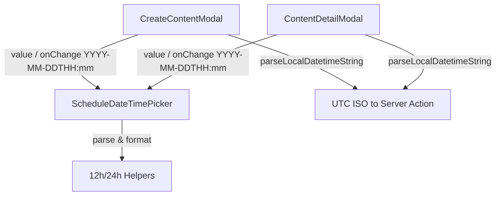

# Content Schedule Time & AM/PM Picker Implementation Plan

> **For agentic workers:** REQUIRED SUB-SKILL: Use superpowers:subagent-driven-development (recommended) or superpowers:executing-plans to implement this plan task-by-task. Steps use checkbox (`- [ ]`) syntax for tracking.

**Goal:** Replace `<input type="datetime-local">` in content creation and editing with an explicit date picker, 12-hour hour/minute dropdowns, and AM/PM toggle buttons.

**Architecture:** Extract pure 12-hour ↔ 24-hour `YYYY-MM-DDTHH:mm` conversion helpers and a reusable `ScheduleDateTimePicker` component under `src/components/content/`, then wire it into `CreateContentModal` and `ContentDetailModal` while keeping `scheduledAt` in the existing `YYYY-MM-DDTHH:mm` local string format so timezone conversion and backend schemas stay untouched.

**Architecture Diagram:**



**Tech Stack:** Next.js 16 (App Router), React 19, TypeScript, Tailwind CSS, Vitest.

**Spec:** [2026-11-17-content-schedule-am-pm-design.md](file:///Users/temoooo/.gemini/antigravity/worktrees/miler%20creator/content_schedule_am_pm/docs/superpowers/specs/2026-11-17-content-schedule-am-pm-design.md)

## Global Constraints

- Keep `scheduledAt` state as `YYYY-MM-DDTHH:mm` (or `""` when unscheduled) and preserve `toLocalDatetimeString` / `parseLocalDatetimeString` timezone conversion.
- Do not modify database schema, server actions, validation schemas, or task/calendar-block modals.
- Support hours `1`–`12`, minutes `00`–`55` in 5-minute steps (plus any existing non-5-minute value when editing), and explicit `AM` / `PM` toggle buttons.

## Review Focus

- Midnight (`12:00 AM` ↔ `00:00`) and noon (`12:00 PM` ↔ `12:00`) conversion must not invert or off-by-12.
- Picking a date when `value` is `""` must initialize time to `09:00 AM` (`09:00`), not emit an incomplete date-only string.
- Clearing the date input must emit `""` so the item can be saved as unscheduled.
- Editing an item whose existing `scheduled_at` has a non-5-minute value (e.g. `14:23`) must display `2:23 PM` instead of snapping to `2:20 PM`.
- Changing hour, minute, or AM/PM when no date is selected must not emit a broken `THH:mm` string without a date.

---

### Task 1: Schedule DateTime Helpers & `ScheduleDateTimePicker` Component

**Files:**
- Create: `src/components/content/ScheduleDateTimePicker.tsx`
- Test: `tests/content-schedule-picker.test.tsx`

**Interfaces:**
- Produces:
  - `export type Meridiem = 'AM' | 'PM'`
  - `export interface ParsedScheduleParts { date: string; hour12: string; minute: string; meridiem: Meridiem }`
  - `export function parseScheduleValue(value: string): ParsedScheduleParts`
  - `export function formatScheduleValue(parts: ParsedScheduleParts): string`
  - `export function ScheduleDateTimePicker(props: { id?: string; value: string; onChange: (nextValue: string) => void; disabled?: boolean; className?: string; }): React.ReactElement`

- [ ] **Step 1: Write the failing unit & render tests**

Create `tests/content-schedule-picker.test.tsx`:
```tsx
import React from 'react';
import { describe, it, expect } from 'vitest';
import { renderToStaticMarkup } from 'react-dom/server';
import {
  parseScheduleValue,
  formatScheduleValue,
  ScheduleDateTimePicker,
} from '../src/components/content/ScheduleDateTimePicker';

describe('ScheduleDateTimePicker conversion helpers', () => {
  it('defaults empty value to empty date and 09:00 AM', () => {
    expect(parseScheduleValue('')).toEqual({
      date: '',
      hour12: '9',
      minute: '00',
      meridiem: 'AM',
    });
    expect(
      formatScheduleValue({ date: '', hour12: '9', minute: '00', meridiem: 'AM' })
    ).toBe('');
  });

  it('converts midnight (00:xx) and noon (12:xx) accurately', () => {
    expect(parseScheduleValue('2026-11-17T00:05')).toEqual({
      date: '2026-11-17',
      hour12: '12',
      minute: '05',
      meridiem: 'AM',
    });
    expect(
      formatScheduleValue({ date: '2026-11-17', hour12: '12', minute: '05', meridiem: 'AM' })
    ).toBe('2026-11-17T00:05');

    expect(parseScheduleValue('2026-11-17T12:30')).toEqual({
      date: '2026-11-17',
      hour12: '12',
      minute: '30',
      meridiem: 'PM',
    });
    expect(
      formatScheduleValue({ date: '2026-11-17', hour12: '12', minute: '30', meridiem: 'PM' })
    ).toBe('2026-11-17T12:30');
  });

  it('converts afternoon/evening hours and preserves non-5-minute values', () => {
    expect(parseScheduleValue('2026-11-17T14:23')).toEqual({
      date: '2026-11-17',
      hour12: '2',
      minute: '23',
      meridiem: 'PM',
    });
    expect(
      formatScheduleValue({ date: '2026-11-17', hour12: '11', minute: '55', meridiem: 'PM' })
    ).toBe('2026-11-17T23:55');
  });
});

describe('ScheduleDateTimePicker rendering', () => {
  it('renders date input, hour/minute selects, and AM/PM toggle buttons without datetime-local', () => {
    const html = renderToStaticMarkup(
      <ScheduleDateTimePicker
        id="test-schedule"
        value="2026-11-17T14:23"
        onChange={() => {}}
      />
    );
    expect(html).not.toContain('datetime-local');
    expect(html).toContain('type="date"');
    expect(html).toContain('value="2026-11-17"');
    expect(html).toContain('>AM<');
    expect(html).toContain('>PM<');
    expect(html).toContain('value="23"');
  });
});
```

- [ ] **Step 2: Run test to verify it fails**

Run: `npx vitest run tests/content-schedule-picker.test.tsx`
Expected: FAIL because `src/components/content/ScheduleDateTimePicker.tsx` does not exist.

- [ ] **Step 3: Implement `ScheduleDateTimePicker.tsx`**

Create `src/components/content/ScheduleDateTimePicker.tsx` with:
- `parseScheduleValue(value: string): ParsedScheduleParts` parsing `YYYY-MM-DDTHH:mm` into 12-hour parts (defaulting empty/invalid to `{ date: '', hour12: '9', minute: '00', meridiem: 'AM' }`).
- `formatScheduleValue(parts: ParsedScheduleParts): string` returning `""` if `!parts.date`, otherwise converting `12 AM` → `00`, `12 PM` → `12`, `1–11 PM` → `13–23` and formatting `YYYY-MM-DDTHH:mm`.
- `ScheduleDateTimePicker` rendering:
  - `<input id={id} type="date" ... />`
  - Hour `<select aria-label="Hour">` (`1`–`12`)
  - Minute `<select aria-label="Minute">` (`00`, `05`, ..., `55`, plus `parts.minute` sorted in if not already present)
  - Segmented `AM` / `PM` `<button type="button" aria-pressed={...}>` controls styled with the project's CSS variables (`--bg-surface`, `--text-primary`, `--bg-canvas`, `--border-subtle`).

- [ ] **Step 4: Run test to verify it passes**

Run: `npx vitest run tests/content-schedule-picker.test.tsx`
Expected: PASS (4 passed).

- [ ] **Step 5: Commit**

```bash
git add src/components/content/ScheduleDateTimePicker.tsx tests/content-schedule-picker.test.tsx
git commit -m "feat(content): add ScheduleDateTimePicker with explicit AM/PM controls"
```

---

### Task 2: Integrate `ScheduleDateTimePicker` into `CreateContentModal` and `ContentDetailModal`

**Files:**
- Modify: `src/components/content/CreateContentModal.tsx:452-469`
- Modify: `src/components/content/ContentDetailModal.tsx:571-589`
- Test: `tests/content-schedule-picker.test.tsx`

**Interfaces:**
- Consumes: `ScheduleDateTimePicker` from `@/components/content/ScheduleDateTimePicker`

- [ ] **Step 1: Write failing modal render tests**

Append to `tests/content-schedule-picker.test.tsx`:
- Mock `@/lib/actions/content-actions` and `@/lib/hooks/use-dialog` (if needed for SSR) or use `renderToStaticMarkup` with `isOpen={true}` for both `CreateContentModal` and `ContentDetailModal` (in view/edit, or verify `CreateContentModal` renders `type="date"`, `aria-label="Hour"`, `aria-label="Minute"`, `>AM<`, `>PM<`, and not `datetime-local`).
- Also verify `ContentDetailModal.tsx` and `CreateContentModal.tsx` no longer contain `type="datetime-local"` and both import `ScheduleDateTimePicker`.

- [ ] **Step 2: Run test to verify it fails**

Run: `npx vitest run tests/content-schedule-picker.test.tsx`
Expected: FAIL because `CreateContentModal` still renders `type="datetime-local"`.

- [ ] **Step 3: Update `CreateContentModal.tsx` and `ContentDetailModal.tsx`**

In `src/components/content/CreateContentModal.tsx`:
- Import `ScheduleDateTimePicker` from `./ScheduleDateTimePicker`.
- Replace the `<input type="datetime-local" ... />` block (lines 458–468) with:
  ```tsx
  <ScheduleDateTimePicker
    value={scheduledAt}
    onChange={(nextValue) => {
      setScheduledAt(nextValue);
      if (nextValue && status === 'idea') {
        setStatus('scheduled');
      }
    }}
  />
  ```

In `src/components/content/ContentDetailModal.tsx`:
- Import `ScheduleDateTimePicker` from `./ScheduleDateTimePicker`.
- Replace the `<input id="detail-schedule" type="datetime-local" ... />` block (lines 579–585) with:
  ```tsx
  <ScheduleDateTimePicker
    id="detail-schedule"
    value={scheduledAt}
    onChange={setScheduledAt}
  />
  ```

- [ ] **Step 4: Run tests & typecheck**

Run: `npx vitest run tests/content-schedule-picker.test.tsx tests/content-notifications-ui.test.tsx`
Run: `npx tsc --noEmit`
Expected: All tests PASS and `tsc` exits 0.

- [ ] **Step 5: Commit**

```bash
git add src/components/content/CreateContentModal.tsx src/components/content/ContentDetailModal.tsx tests/content-schedule-picker.test.tsx
git commit -m "feat(content): use ScheduleDateTimePicker in create and edit modals"
```

---

## Self-Review

1. **Spec coverage:** `ScheduleDateTimePicker` with date input, 1–12 hour select, 5-minute + existing-minute select, AM/PM buttons, `09:00 AM` default, clear-to-empty, and integration into both `CreateContentModal` and `ContentDetailModal` are all covered.
2. **Step scan:** Every step specifies exact file paths, signatures, test assertions, and commands.
3. **Type consistency:** `ParsedScheduleParts`, `parseScheduleValue`, `formatScheduleValue`, and `ScheduleDateTimePicker` match across Task 1 and Task 2.
4. **Review Focus:** All 5 edge cases (midnight/noon, empty-date default, clear date, non-5-minute preservation, time change without date) are pinned in Task 1 tests.
5. **Proportion:** Concise 2-task plan proportional to the short spec.
