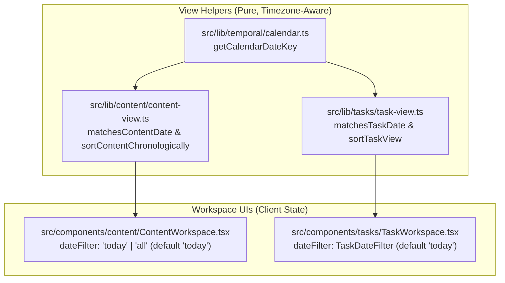

# Content & Tasks Daily Toggle and Chronological Order Implementation Plan

> **For agentic workers:** REQUIRED SUB-SKILL: Use superpowers:subagent-driven-development (recommended) or superpowers:executing-plans to implement this plan task-by-task. Steps use checkbox (`- [ ]`) syntax for tracking.

**Goal:** Default both Content and Tasks workspaces to showing Today's assigned items (with a `Today | All` toggle) and order items chronologically from earliest to latest.

**Architecture:** Extract Content date-matching and chronological sorting into a pure helper module (`src/lib/content/content-view.ts`) mirroring `src/lib/tasks/task-view.ts`, update `sortTaskView` in `src/lib/tasks/task-view.ts` so `'default'` and `'due'` sort chronologically by `scheduled_start ?? due_date` ascending, and wire the `Today` default + segmented toggles into `ContentWorkspace.tsx` and `TaskWorkspace.tsx`.

**Architecture Diagram:**



**Tech Stack:** Next.js 16 (App Router, React 19), TypeScript, Tailwind CSS v4, Vitest.

**Spec:** [2026-11-19-content-tasks-daily-toggle-design.md](file:///Users/temoooo/.gemini/antigravity/worktrees/miler%20creator/content_tasks_daily_toggle/docs/superpowers/specs/2026-11-19-content-tasks-daily-toggle-design.md)

## Global Constraints

- Strictly `Today` vs. `All` (no date picker or multi-day stepper).
- No server-side query changes or URL round-trips on toggle clicks.
- Must respect `userTimeZone` via `getCalendarDateKey` when determining "Today".
- Preserve deep links (`initialContentId`, `initialTaskId`, `initialDateFilter`, `initialTab`).
- Preserve existing Content tabs (`All Content`, `Idea Inbox`, `Drafts`, `Scheduled`, `Archived`) and Tasks filters (`Today`, `Any date`, `Overdue`, `No date`, priority, project, status).

## Review Focus

- **Timezone midnight boundary:** Items scheduled near UTC midnight (e.g. `2026-11-04T23:30:00Z`) must match `2026-11-05` in `Africa/Cairo` (`UTC+2`) and items at `2026-11-05T23:30:00Z` must not — pinned in Task 1 and Task 2.
- **Deep-link visibility:** Opening Content with `initialContentId` or Tasks with `initialTaskId` for an item not assigned today must default `dateFilter` to `'all'` so the item is visible — pinned in Task 3 and Task 4.
- **Unscheduled Content tabs & creation:** Switching to `Idea Inbox`, `Drafts`, or `Archived` (or creating an unscheduled item) must switch `dateFilter` to `'all'` so unscheduled items aren't hidden by `Today` — pinned in Task 3.
- **Mixed `scheduled_start` / `due_date` and invalid/null timestamps in Tasks:** Tasks with only `scheduled_start`, only `due_date`, or both must sort by `scheduled_start ?? due_date` ascending, with undated or invalid-date tasks placed after dated ones without `NaN` comparator instability — pinned in Task 2.
- **Toggle switching between `Today` and `All`:** Clicking `All` in either workspace reveals non-today items in chronological order, and clicking `Today` narrows back to today's items — pinned in Task 3 and Task 4.

---

### Task 1: Content View Helper (`content-view.ts`)

**Files:**
- Create: `src/lib/content/content-view.ts`
- Test: `tests/content-view.test.ts`

**Interfaces:**
- Consumes: `getCalendarDateKey(dateInput: Date | string | number, timeZone: string): string` from `src/lib/temporal/calendar.ts`, `ContentItemWithMeta` from `src/lib/services/content-service.ts`.
- Produces:
  - `export type ContentDateFilter = 'today' | 'all';`
  - `export function matchesContentDate(item: ContentItemWithMeta, filter: ContentDateFilter, todayKey: string, timeZone: string): boolean`
  - `export function sortContentChronologically(items: ContentItemWithMeta[]): ContentItemWithMeta[]`

- [ ] **Step 1: Write the failing tests in `tests/content-view.test.ts`**

```ts
import { describe, expect, it } from 'vitest';
import { matchesContentDate, sortContentChronologically } from '../src/lib/content/content-view';
import type { ContentItemWithMeta } from '../src/lib/services/content-service';

const content = (overrides: Partial<ContentItemWithMeta> = {}) =>
  ({
    id: 'c1',
    workspace_id: 'w1',
    social_account_id: null,
    platform: 'x',
    action_type: 'post',
    status: 'scheduled',
    title: 'Sample',
    body: 'Body',
    scheduled_at: null,
    duration_minutes: null,
    media_urls: [],
    external_links: [],
    target_reference: null,
    tags: [],
    notes: null,
    project_id: null,
    milestone_id: null,
    recurrence_rule_id: null,
    created_by: null,
    created_at: '2026-11-01T10:00:00Z',
    updated_at: '2026-11-01T10:00:00Z',
    ...overrides,
  }) as ContentItemWithMeta;

describe('Content date filters and chronological sorting', () => {
  it('matches all items when filter is all', () => {
    expect(matchesContentDate(content(), 'all', '2026-11-05', 'Africa/Cairo')).toBe(true);
    expect(
      matchesContentDate(content({ scheduled_at: '2026-11-10T09:00:00Z' }), 'all', '2026-11-05', 'Africa/Cairo')
    ).toBe(true);
  });

  it('uses the workspace timezone across midnight for Today and excludes unscheduled items', () => {
    expect(
      matchesContentDate(content({ scheduled_at: '2026-11-04T23:30:00Z' }), 'today', '2026-11-05', 'Africa/Cairo')
    ).toBe(true);
    expect(
      matchesContentDate(content({ scheduled_at: '2026-11-05T23:30:00Z' }), 'today', '2026-11-05', 'Africa/Cairo')
    ).toBe(false);
    expect(matchesContentDate(content({ scheduled_at: null }), 'today', '2026-11-05', 'Africa/Cairo')).toBe(false);
  });

  it('sorts scheduled items earliest-first and places unscheduled items after (newest created_at first)', () => {
    const input = [
      content({ id: 'unsched-old', scheduled_at: null, created_at: '2026-11-01T08:00:00Z' }),
      content({ id: 'later', scheduled_at: '2026-11-05T15:00:00Z' }),
      content({ id: 'earlier', scheduled_at: '2026-11-05T08:00:00Z' }),
      content({ id: 'unsched-new', scheduled_at: null, created_at: '2026-11-03T08:00:00Z' }),
    ];

    const sorted = sortContentChronologically(input);
    expect(sorted.map((i) => i.id)).toEqual(['earlier', 'later', 'unsched-new', 'unsched-old']);
    expect(input[0].id).toBe('unsched-old');
  });
});
```

- [ ] **Step 2: Run test to verify it fails**

Run: `npx vitest run tests/content-view.test.ts`
Expected: FAIL with module not found (`../src/lib/content/content-view`).

- [ ] **Step 3: Implement `src/lib/content/content-view.ts`**

Create `src/lib/content/content-view.ts` exporting `ContentDateFilter`, `matchesContentDate`, and `sortContentChronologically`:
- `matchesContentDate`: returns `true` if `filter === 'all'`; otherwise requires `Boolean(item.scheduled_at && getCalendarDateKey(item.scheduled_at, timeZone) === todayKey)`.
- `sortContentChronologically`: returns a shallow copy sorted by `scheduled_at` ascending (parsing with `Date.parse`, treating `NaN` or `null` as unscheduled); unscheduled items come after scheduled items, ordered by `created_at` descending.

- [ ] **Step 4: Run test to verify it passes**

Run: `npx vitest run tests/content-view.test.ts`
Expected: PASS (3/3 tests).

- [ ] **Step 5: Commit**

```bash
git add src/lib/content/content-view.ts tests/content-view.test.ts
git commit -m "feat(content): add timezone-aware Today filter and chronological sort helper"
```

---

### Task 2: Task View Chronological Default Sort (`task-view.ts`)

**Files:**
- Modify: `src/lib/tasks/task-view.ts:27-38`
- Modify: `tests/task-view.test.ts:30-38`

**Interfaces:**
- Consumes: `TaskWithMeta` from `src/lib/services/task-service.ts`.
- Produces:
  - `sortTaskView(tasks: TaskWithMeta[], sort: TaskSort): TaskWithMeta[]` where both `'default'` and `'due'` sort chronologically by `scheduled_start ?? due_date` ascending (earliest first), placing undated or invalid-date tasks after dated ones.

- [ ] **Step 1: Add failing tests to `tests/task-view.test.ts`**

Append to `describe('Task date filters and sorting', ...)` in `tests/task-view.test.ts`:

```ts
  it('sorts default order chronologically earliest-first using scheduled_start or due_date, with undated last', () => {
    const input = [
      task({ id: 'undated' }),
      task({ id: 'late-due', due_date: '2026-11-05T17:00:00Z' }),
      task({ id: 'early-sched', scheduled_start: '2026-11-05T08:00:00Z', due_date: '2026-11-05T18:00:00Z' }),
      task({ id: 'mid-sched', scheduled_start: '2026-11-05T11:00:00Z' }),
    ];
    expect(sortTaskView(input, 'default').map((item) => item.id)).toEqual([
      'early-sched',
      'mid-sched',
      'late-due',
      'undated',
    ]);
  });

  it('handles invalid date strings without throwing or breaking chronological order', () => {
    const input = [
      task({ id: 'bad', scheduled_start: 'not-a-date' }),
      task({ id: 'valid', scheduled_start: '2026-11-05T09:00:00Z' }),
    ];
    expect(sortTaskView(input, 'default').map((item) => item.id)).toEqual(['valid', 'bad']);
  });
```

- [ ] **Step 2: Run test to verify it fails**

Run: `npx vitest run tests/task-view.test.ts`
Expected: FAIL on the new `'default'` chronological order test.

- [ ] **Step 3: Update `sortTaskView` in `src/lib/tasks/task-view.ts`**

Add a small helper `getTaskAssignedTimestamp(task: TaskWithMeta): number | null` that parses `task.scheduled_start ?? task.due_date` via `Date.parse` and returns `null` if missing or `Number.isNaN(ms)`. Update `sortTaskView` so `sort === 'default' || sort === 'due'` sorts ascending by `getTaskAssignedTimestamp` (nulls last).

- [ ] **Step 4: Run test to verify it passes**

Run: `npx vitest run tests/task-view.test.ts`
Expected: PASS (all tests in `tests/task-view.test.ts`).

- [ ] **Step 5: Commit**

```bash
git add src/lib/tasks/task-view.ts tests/task-view.test.ts
git commit -m "feat(tasks): default sortTaskView to chronological earliest-first order"
```

---

### Task 3: ContentWorkspace `Today | All` Toggle & Chronological Order

**Files:**
- Modify: `src/components/content/ContentWorkspace.tsx`
- Create: `tests/content-workspace-daily.test.tsx`

**Interfaces:**
- Consumes: `ContentDateFilter`, `matchesContentDate`, `sortContentChronologically` from `@/lib/content/content-view`, `getCalendarDateKey` from `@/lib/temporal/calendar`.
- Modifies: `ContentWorkspace` component state and filter toolbar.

- [ ] **Step 1: Write the failing component tests in `tests/content-workspace-daily.test.tsx`**

Note: Check how React components are tested in `tests/` (e.g., `tests/zahi-design-system.test.tsx` or `react-dom/server` / `@testing-library/react` if installed). Let's check `package.json` — `@testing-library/react` is NOT in `package.json`; let's check how `tests/zahi-design-system.test.tsx` or `tests/marketing-landing-ui.test.tsx` renders components!
Let's make sure the test uses `react-dom/client` + `act` (or `renderToStaticMarkup` for initial render + `act` with `createRoot` if `jsdom` is configured in `vitest.config.mts`). We'll check `vitest.config.mts` during execution or write standard `renderToStaticMarkup` / `createRoot` tests matching existing `.test.tsx` files.

Test cases to include:
1. Defaults to `Today` when no `initialContentId` or unscheduled `initialTab` is provided, showing only items scheduled for today in chronological order (earliest first).
2. Clicking `All` toggles to show all non-archived items in chronological order (scheduled earliest-first, unscheduled after).
3. Defaults to `All` when `initialContentId` is provided or `initialTab` is `'ideas' | 'drafts' | 'archived'`.
4. Switching to `Idea Inbox` or `Drafts` tab sets `dateFilter` to `'all'` so unscheduled items are visible.

- [ ] **Step 2: Run test to verify it fails**

Run: `npx vitest run tests/content-workspace-daily.test.tsx`
Expected: FAIL (toggle not rendered / non-today items shown by default).

- [ ] **Step 3: Update `src/components/content/ContentWorkspace.tsx`**

1. Import `getCalendarDateKey` from `@/lib/temporal/calendar` and `matchesContentDate`, `sortContentChronologically`, `type ContentDateFilter` from `@/lib/content/content-view`.
2. Add `clock` (or `useState(() => new Date())` with 60s interval, matching `TaskWorkspace.tsx`) and `todayKey = getCalendarDateKey(clock, userTimeZone)`.
3. Add `dateFilter` state:
   ```ts
   const [dateFilter, setDateFilter] = useState<ContentDateFilter>(() => {
     if (initialContentId) return 'all';
     if (initialTab === 'ideas' || initialTab === 'drafts' || initialTab === 'archived') {
       return 'all';
     }
     return 'today';
   });
   ```
4. When switching tabs (metric cards, tab buttons, keyboard shortcuts `1`-`5`):
   - If target tab is `'ideas'`, `'drafts'`, or `'archived'`, set `dateFilter('all')`.
5. In `handleContentCreated(newItem)`:
   - If `!newItem.scheduled_at`, set `dateFilter('all')` so the newly captured idea/draft is immediately visible.
6. In `displayedItems`:
   - Filter with `matchesContentDate(item, dateFilter, todayKey, userTimeZone)` and wrap the returned array in `sortContentChronologically(...)`.
7. Render the `Today | All` segmented control in the filter toolbar (matching `TaskWorkspace.tsx`'s segmented control styling with `aria-label="Filter content by date"` and `aria-pressed`).

- [ ] **Step 4: Run test to verify it passes**

Run: `npx vitest run tests/content-workspace-daily.test.tsx tests/content-workspace.test.ts`
Expected: PASS.

- [ ] **Step 5: Commit**

```bash
git add src/components/content/ContentWorkspace.tsx tests/content-workspace-daily.test.tsx
git commit -m "feat(content): default ContentWorkspace to Today toggle and chronological order"
```

---

### Task 4: TaskWorkspace `Today` Default & Chronological Sort Label

**Files:**
- Modify: `src/components/tasks/TaskWorkspace.tsx:103-108,573-599,640-644`
- Create: `tests/task-workspace-daily.test.tsx`

**Interfaces:**
- Consumes: `matchesTaskDate`, `sortTaskView`, `TaskDateFilter`, `TaskSort` from `@/lib/tasks/task-view`.
- Modifies: `TaskWorkspace` initial `dateFilter` state, date segmented control order (`Today | Any date | Overdue | No date`), and default sort option label (`Time: earliest first`).

- [ ] **Step 1: Write the failing component tests in `tests/task-workspace-daily.test.tsx`**

Test cases to include:
1. Defaults `dateFilter` to `'today'` when `initialDateFilter` and `initialTaskId` are omitted, showing only today's tasks sorted earliest-first.
2. Defaults `dateFilter` to `'all'` when `initialTaskId` is provided (so deep-linked tasks on other days remain visible), and respects explicit `initialDateFilter` when valid.
3. Renders `Today` as `aria-pressed="true"` by default and allows toggling to `Any date` to see all tasks in chronological order.

- [ ] **Step 2: Run test to verify it fails**

Run: `npx vitest run tests/task-workspace-daily.test.tsx`
Expected: FAIL (`Any date` is currently default `aria-pressed="true"`).

- [ ] **Step 3: Update `src/components/tasks/TaskWorkspace.tsx`**

1. Update `dateFilter` initial state:
   ```ts
   const [dateFilter, setDateFilter] = useState<TaskDateFilter>(() => {
     if (initialDateFilter && VALID_DATE_FILTERS.includes(initialDateFilter as TaskDateFilter)) {
       return initialDateFilter as TaskDateFilter;
     }
     if (initialTaskId) return 'all';
     return 'today';
   });
   ```
2. Put `{ id: 'today', label: 'Today' }` first in the date filter segmented control (`Today | Any date | Overdue | No date`).
3. Update the default `<option value="default">` label in the Sort selector from `Original order` to `Time: earliest first`.

- [ ] **Step 4: Run tests to verify they pass**

Run: `npx vitest run tests/task-workspace-daily.test.tsx tests/tasks-page.test.ts tests/task-view.test.ts`
Expected: PASS.

- [ ] **Step 5: Commit**

```bash
git add src/components/tasks/TaskWorkspace.tsx tests/task-workspace-daily.test.tsx
git commit -m "feat(tasks): default TaskWorkspace to Today and chronological order"
```

---

### Final Verification

- [ ] Run full test suite (`npm test`) and lint/typecheck (`npm run lint`, `npx tsc --noEmit`) to confirm zero regressions.
